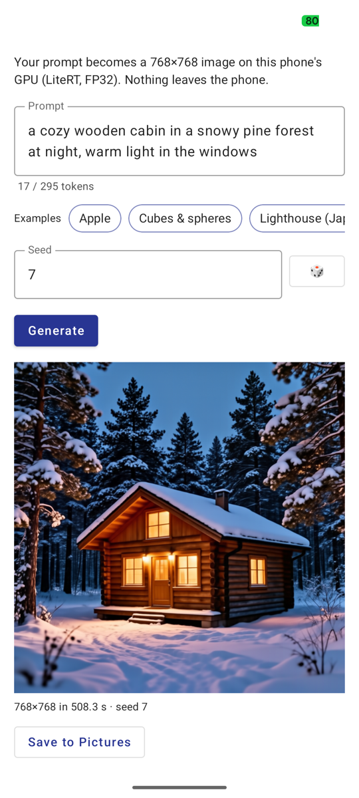

# iris-3b on LiteRT GPU — type a prompt, get a 768×768 image on the phone

Type a prompt on your phone and **Speridlabs' iris-3b Turbo** (Apache-2.0) draws it at 768×768
on the phone's GPU through LiteRT `CompiledModel`. No upload, no account, no server: the app does
not request the `INTERNET` permission.

All 20 graphs — the Qwen3-VL-4B text encoder, the text adapter and the pixel-space DiT — run as
`Accelerator.GPU` graphs at FP32 precision. iris-3b draws pixels directly (no VAE), and Turbo
needs 4 steps with no classifier-free guidance.



*"a cozy wooden cabin in a snowy pine forest at night, warm light in the windows", seed 7, made in the app on a Pixel 8a in 508.3 s (its first image after the install, with the screen being recorded).*

A 13.6 s video of this run (prompt, Generate, image; the middle sped up) is in the [model card's Demo section](https://huggingface.co/litert-community/iris-3b-Turbo-LiteRT#demo).

| | |
|---|---|
| Model | `speridlabs/iris-3b` Turbo, rev `adc05b9` (Apache-2.0): 3B pixel-space DiT, 4 steps, no CFG |
| Text encoder | `Qwen/Qwen3-VL-4B-Instruct`, rev `ebb281e` (Apache-2.0): text only, 12 hidden-state taps |
| Graphs | 20 LiteRT graphs, 12.87 GB: fp16 weights (`DEQUANTIZE`) with fp32 activations; largest 909 MB |
| On the phone | 24 files, 13.7 GB (graphs, bf16 embedding table, host tensors, tokenizer, config) |
| Output | 768 × 768: the smallest of the sizes tried with the upstream PyTorch pipeline (256², 512², 768², 1024²) that comes out clean; 512² and 256² break up |
| First image in this app | Galaxy S26: 212.6 s (text encoder 27.2 s compile + 2.2 s run, adapter 5.6 + 0.9 s, DiT 100.1 s compile + 74.4 s run, closing graphs 1.6 s). Pixel 8a: 468.8 s (38.0 + 5.6 s, 5.1 + 2.0 s, 267.1 + 141.5 s, closing 7.8 s). Each the app's first image after the install, thermal status 0 at the start |
| Quality vs PyTorch | all-fp32 upstream pipeline, same noise, 3 prompts, through this app's Generate path: Galaxy S26 106.84 / 74.02 / 72.57 dB PSNR, SSIM ≥ 0.99999; Pixel 8a 106.76 / 70.92 / 73.09 dB, SSIM 1.0 |

## Install

1. Build and install the app (a debug build: the install script copies with `run-as`).

   ```bash
   ./gradlew :app:installDebug
   ```

2. Download the model folder (24 files, 13.7 GB) from
   [litert-community/iris-3b-Turbo-LiteRT](https://huggingface.co/litert-community/iris-3b-Turbo-LiteRT):

   ```bash
   hf download litert-community/iris-3b-Turbo-LiteRT --include "model/*" --local-dir iris-3b-Turbo-LiteRT
   ```

3. Copy it into the app's private storage:

   ```bash
   ./install_to_device.sh iris-3b-Turbo-LiteRT/model
   ```

   The script reads the phone's free space first and stops when the files plus 3 GB do not fit. It
   streams each file straight into the app (`adb exec-in` + `run-as`), so nothing is staged on the
   phone, checks each by size (and by sha256 when the folder has `SHA256SUMS`), and skips files
   already there, so running it again resumes an interrupted install. `adb uninstall com.iris3b`
   removes the app and the files.

4. Open **iris-3b**, type a prompt (or tap an example), and press **Generate**. Until the files are
   installed, the app shows the install command and Generate stays off.

The prompt editor counts tokens as you type. After the chat template's 34-token prefix, the text
encoder reads a 300-token window, and the template's suffix takes 5 of it: up to
295 prompt tokens. A longer prompt is cut, and the app says so. A seed field (and a dice button)
picks the starting noise.

## How it works

```
prompt -> Qwen tokenizer (Kotlin port) -> bf16 embedding lookup (host)
       -> 12 text encoder graphs, one per hidden-state tap (layers 2, 5, ..., 35)
       -> text adapter graph (once per prompt)
       -> 4 steps x (3 dual-stream + 3 single-stream graphs + pixel-stage graph) -> sampler (host)
       -> 768x768 RGB
```

Each graph is compiled for its run and closed again, so only one graph's weights sit in GPU memory
at a time. The weights are the checkpoint's bf16 values stored as fp16 constants (litert-torch's
`full_fp16_recipe`), computed in fp32: half the size of fp32 graphs, with the image at
70.92–106.84 dB PSNR (SSIM ≥ 0.99999) against the all-fp32 PyTorch image on both phones.
Lower precision does not hold the image: fp16 GPU compute, int8 weights, or an int8 text encoder each
change the fine detail of some prompts.

Memory: on a Pixel 8a, free memory (MemAvailable) was 3.6–3.8 GiB before an image and
288–444 MiB at its lowest during one, and Android's low-memory killer closed 116–169 other
processes during each image (never this app). The app reads MemAvailable every 200 ms and, when
it falls below 200,000 kB (about 195 MiB), stops before the next graph and says so instead of being
closed by Android.
Close other apps before generating on a phone with that little free memory.

## Checking the image against PyTorch

Debug builds take extras so a computer can drive the app:

```bash
adb shell am start -n com.iris3b/.MainActivity --es verify apple
```

makes the "apple" example from the upstream reference run's noise and writes
`files/verify_apple.npy` (float32 `[1, 3, 768, 768]`, the clamped image in [-1, 1]) and
`files/verify_apple.json` (stage times, memory, status). `scripts/score_image.py` compares it (PSNR
and SSIM on (x + 1) / 2) with an all-fp32 image that you make with the upstream PyTorch pipeline
from the same noise (`noise_pix` in `iris_host.f32`); the reference images are not in this
repository. Other extras: `prompt` /
`prompt_b64`, `seed`, `autoplay`, `guard_kb`, `on_top` (see `MainActivity.kt`). A seed typed in the
app uses `java.util.Random`, not torch's generator, so it does not reproduce the upstream image of
the same seed.

## Notes

- After a memory-guard stop, the previous image stays on screen below the message; no new image was made.
- The GPU program cache (`GpuOptions(serializeProgramCache = true)`) is off: LiteRT's GPU program cache
  also writes the weights in their GPU form, so it needs a large amount of free storage with these graphs.
- One `Environment` is created per process and shared: a `CompiledModel` created without one (a null
  `Environment`) leaks an OpenCL context per compile.
- The engine also has a `P4` residency (compile the next graph while the current one runs). On the
  Galaxy S26 it made the first image 149.1 s (from thermal status 0), but the GPU
  driver ended the app during the third image in a row; the app ships `P1`.
- `BenchActivity` is the measurement entry used during conversion (its driver scripts are not in this
  folder); the app's launcher is `MainActivity`.

## License

The app code in this folder is under the repository's MIT license (`LICENSE` at the repository
root). The model files are converted from two Apache-2.0 checkpoints and keep that license:

- **iris-3b** (Turbo) — Copyright 2026 Speridlabs, Apache License 2.0
  ([model](https://huggingface.co/speridlabs/iris-3b), [code](https://github.com/speridlabs/iris-3b)).
- **Qwen3-VL-4B-Instruct** (the text encoder and its embedding table and tokenizer) — Alibaba Cloud,
  Apache License 2.0 ([model](https://huggingface.co/Qwen/Qwen3-VL-4B-Instruct)).
