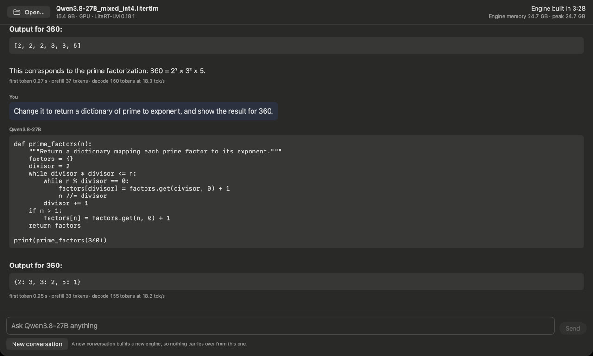

# LiteRT-LM Chat for Mac — a 27B model on the Mac's GPU

**This is a personal project, not a Google product.**

A SwiftUI chat app for Apple Silicon Macs. Open one `.litertlm` file, type a question, and the answer streams from the Mac's GPU through Google's [LiteRT-LM](https://github.com/google-ai-edge/LiteRT-LM) runtime (its Swift package, 0.18.1). No Python, no server. The example model is [Qwen3.8-27B](https://huggingface.co/litert-community/Qwen3.8-27B): one 15.4 GB file that decodes at about 18.4 tokens per second in this app on a Mac Studio M4 Max.



## What you need

- An Apple Silicon Mac with **32 GB of memory or more** for Qwen3.8-27B: its engine used up to 24.95 GB in this app, and macOS and your other apps need the rest. Every number here comes from a 128 GB Mac; a 32 GB Mac was not tried. The app refuses a file whose engine would not fit in the Mac's memory; it estimates 1.65 × the file size.
- macOS 14 or later, Xcode and [XcodeGen](https://github.com/yonaskolb/XcodeGen) (`brew install xcodegen`). Built and run here with Xcode 27.0 on macOS 27.0.
- About 16 GB of free disk for the model file.

## Get the model

```bash
pip install -U huggingface_hub
hf download litert-community/Qwen3.8-27B Qwen3.8-27B_mixed_int4.litertlm --local-dir ~/models
```

The file is 15,379,451,056 bytes, sha256 `7396292ecec0741f166fb57ed65198c34a3f854b40e01951310e0b94f79d449f` ([model card](https://huggingface.co/litert-community/Qwen3.8-27B)). Keep the `.litertlm` extension: LiteRT-LM reads the format from the file name.

## Build and run

```bash
xcodegen generate
open LiteRTLMChat.xcodeproj        # then Run (⌘R)
```

or without opening Xcode:

```bash
xcodegen generate
xcodebuild -project LiteRTLMChat.xcodeproj -scheme LiteRTLMChat -configuration Release -derivedDataPath build build
open build/Build/Products/Release/LiteRTLMChat.app
```

The first build resolves the LiteRT-LM package from GitHub, which checks out the whole repository with its prebuilt libraries (about 1.6 GB on disk). The app is signed to run locally, so no Apple developer account is needed.

Then **Open…** the `.litertlm` file, wait for the engine, and ask. You can type your first question while the engine builds.

## What the window shows

- The file's name and size; the build clock while the engine builds, then the build time; and the engine process's memory, now and at its peak.
- Under every answer: the time to the first token, and the prefill and decode token counts with LiteRT-LM's own rates for that answer. A rate over a few tokens is mostly the fixed cost of a call, so the prefill rate shows from 64 tokens and the decode rate from 16; the engine log has every count and rate. While an answer streams, the window shows a live rate from the engine process's own timestamps on each piece of text, so a busy window does not distort it.
- Math written in LaTeX shows as plain text (`$$x = \frac{23 - 5y}{3}$$` reads `x = (23 - 5y)/3`).
- Example questions to click when a conversation is empty; Qwen3.8-27B answered all four correctly in the runs below.
- What went wrong, when something does: a file that is not there, a name without `.litertlm`, a file LiteRT-LM cannot read, a Mac with too little memory, or an engine process that stopped (force-quit, or out of memory).

## Measured in this app

Mac Studio M4 Max (128 GB), macOS 27.0, the file above, 2026-10-23 and 24, ten runs of the recorder described below (20 engines):

| | |
|---|---|
| Engine build, start of the engine process to ready | 199–240 s |
| Time to the first token, prompts of 19–53 tokens | 0.91–1.84 s |
| Decode, answers of 301–942 tokens | 18.29–18.53 tok/s (18.19–18.58 on every answer of 16 tokens or more) |
| Peak memory of the engine process | 24.95 GB |
| The model card's 8 questions, one conversation each | 8/8, the card's answers word for word |
| The model card's three-turn conversation | the card's three replies word for word |
| WebGPU validation errors | 0 lines in the 20 engines' logs |

## How it works

- **One engine process per conversation.** The window starts its own executable again as a headless engine host (`--engine-host`) and talks to it in JSON lines; **New conversation** ends that process and starts a new one, so a conversation never sees the one before it. Two reasons, both from the model card: a new conversation on an engine that already ran one can continue from the earlier conversation's recurrent state ([LiteRT-LM issue 3165](https://github.com/google-ai-edge/LiteRT-LM/issues/3165)), and on the Mac GPU, processes that built four engines one after another logged WebGPU validation errors in 2 of 44 engines (on variants of this file; this file's own 12 such engines logged none), both times the third engine of its process, while 130 processes that built one engine each logged none. The cost is the engine build, every conversation: 199–240 s for Qwen3.8-27B. A side effect: if an engine runs the Mac out of memory, macOS ends that process, not the window, and the window says what happened (tried by force-quitting the engine process).
- **Stop ends the conversation.** LiteRT-LM 0.18.1 does not go on with a session after a cancel ("Reusing the session after calling CancelProcess() is neither recommended nor supported", [`runtime/core/session_advanced.h`](https://github.com/google-ai-edge/LiteRT-LM/blob/v0.18.1/runtime/core/session_advanced.h#L185-L187)), and the next message fails with "Task cancelled". So **Stop** keeps what was written, closes that conversation's engine and offers a new conversation.
- **GPU, no cache.** The engine runs on the GPU (WebGPU on Metal, linked into LiteRT-LM's Mac library) with LiteRT-LM's cache turned off (`cacheDir ":nocache"`). With the cache on, LiteRT-LM writes about 16 GB of GPU weight and program caches next to the model file, and for this model a run with the cache was not faster: 236 s with the cache against 232 s without (LiteRT-LM's command-line tool on 2026-10-21, one question per run, the same weights; a block-32 build of the same export was slower with its cache too).
- **Greedy decoding.** The app sets no sampler, so the file's own applies. Qwen3.8-27B's file declares none, and LiteRT-LM 0.18.1 then uses top-k 1 on the GPU, the most likely token at every step, as the model card's checks did.
- **Thinking off.** Qwen3.8-27B's file runs with thinking off only. The app shows an answer's text; the thought channel of a file that declares one is not shown, and tool calls are not handled.
- **WebGPU errors are surfaced.** On LiteRT-LM 0.18.1 a WebGPU validation error does not stop the engine, but the answers after it can be wrong. The window reads the engine's log as it is written and shows a warning on the first such line.
- **No App Nap while an engine runs**, so a window that is not in front keeps up with the answer.

## Recorder: the checks without clicking

```bash
APP=build/Build/Products/Release/LiteRTLMChat.app/Contents/MacOS/LiteRTLMChat
"$APP" --model ~/models/Qwen3.8-27B_mixed_int4.litertlm --autoplay checks/card_8q.json --run-out run_8q.json
"$APP" --model ~/models/Qwen3.8-27B_mixed_int4.litertlm --autoplay checks/card_3turn.json --run-out run_3turn.json
```

The recorder types into the same field and presses the same Send, Stop and New conversation as a person does, then writes a run JSON: every answer and its check, LiteRT-LM's counters, each engine's build time, peak memory, WebGPU error lines and the wall-clock times of each step. `checks/card_8q.json` asks the model card's eight questions, each in a new conversation; `checks/card_3turn.json` is the card's three-turn conversation. `--snapshot-dir <dir>` also saves pictures of the window. The script format is at the top of `Sources/Autoplay.swift`.

Other options, given as `-key value`: `-logDirectory <dir>`, `-runtimeLog info` (LiteRT-LM's log level), `-windowFrame "x,y,w,h"`, `-windowFloating YES` (for screen recordings), and `-assumePhysicalMemoryGB 16`, which shows the not-enough-memory screen on a Mac that has enough.

## Logs

`~/Library/Logs/LiteRTLMChat/engine-*.log`, one per conversation: LiteRT-LM's messages and a `[host]` line per answer with its counters.

## Files

| File | What it does |
|---|---|
| `Sources/ChatModel.swift` | The window's state: open a file, check it, build the engine, send, stop, new conversation |
| `Sources/ChatView.swift`, `MarkdownText.swift` | The window, and Markdown and math in answers |
| `Sources/EngineClient.swift` | Starts the engine process, relays its events, writes its log |
| `Sources/EngineHost.swift` | The engine process: LiteRT-LM `Engine` and `Conversation` |
| `Sources/Autoplay.swift` | The recorder and the answer checks |
| `checks/` | Recorder scripts |
| `project.yml` | XcodeGen project (the LiteRT-LM package pinned at 0.18.1) |
